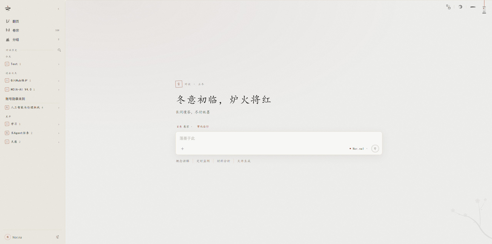
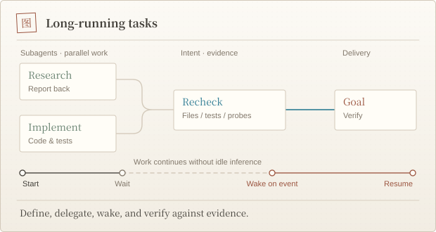
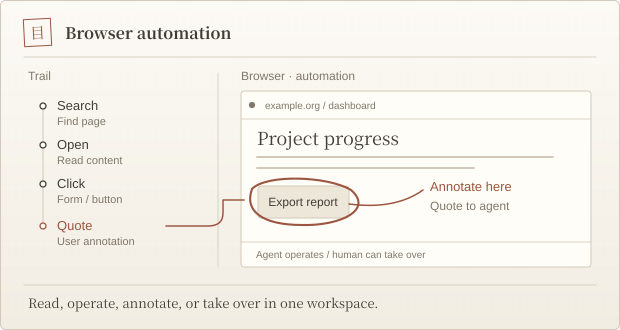
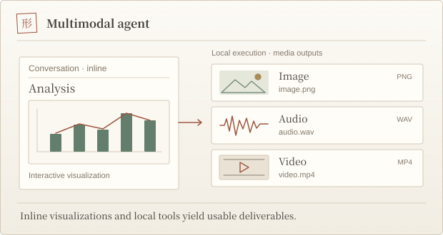
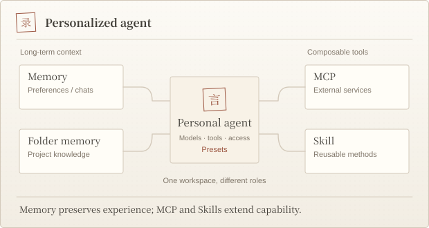

<div align="center">


<h1>言 · Yan</h1>

<strong>A personal agent for long-running collaboration.</strong>

<p>Plainness for bones, paper and ink for spirit.</p>

<a href="LICENSE"></a>
<a href="https://github.com/Master-Norna/yan/releases/latest"></a>
<a href="docs/en/models.md"></a>
<a href="https://github.com/topics/javascript"></a>
<a href="https://github.com/topics/nodejs"></a><br>
<a href="https://github.com/topics/ai-agent"></a>
<a href="https://github.com/topics/local-first"></a>
<a href="https://github.com/topics/browser-automation"></a>
<a href="https://github.com/topics/chat-ui"></a><br>
<a href="https://github.com/topics/mcp"></a>
<a href="https://github.com/topics/openai-compatible"></a>
<a href="https://github.com/topics/rsi"></a>

[Download](https://github.com/Master-Norna/yan/releases/latest) · [Docs](docs/en/README.md) · [中文](README.md)

</div>

Yan brings conversation, research, development and task execution into one local environment. Choose your own models, continue work in a local folder, and inspect the execution trail and deliverables. A conversation becomes an agent workspace as soon as you bind it to a folder.

<p align="center">
  
</p>

##  Distinctive capabilities

<table>
<tr>
<td width="45%" valign="middle"><h3>Long-running tasks</h3><p>Intent structures goals, dependencies and acceptance evidence; subagents work in parallel, and waits wake the agent on time or events. Execution, waiting, resumption and verification extend complex work beyond a single reply.</p><a href="docs/en/work.md">Learn more</a></td>
<td width="55%" valign="middle"></td>
</tr>
<tr>
<td width="55%" valign="middle"></td>
<td width="45%" valign="middle"><h3>Browser automation</h3><p>The browser panel exposes the agent's browser to the user. Search, interaction and automation share a workspace where users can take over and annotate or quote the page directly.</p><a href="docs/en/stage.md">Learn more</a></td>
</tr>
<tr>
<td width="45%" valign="middle"><h3>Multimodal agent</h3><p>Conversations embed interactive charts and visualizations, with files as deliverables. The local execution environment and appropriate tools can produce images, audio, video and other digital media.</p><a href="docs/en/chat.md">Learn more</a></td>
<td width="55%" valign="middle"></td>
</tr>
<tr>
<td width="55%" valign="middle"></td>
<td width="45%" valign="middle"><h3>Personalized agent</h3><p>Memory preserves long-term context, MCP connects external services, and Skills capture reusable methods. Combine models, tools and permissions in presets to tailor an agent to a domain or task.</p><a href="docs/en/memory.md">Learn more</a></td>
</tr>
</table>

##  Product capabilities

| Conversation & creation | Search & research |
| --- | --- |
| Multi-turn chat, branches and versions, side threads, mid-reply follow-ups, attachments and interactive charts. | Web search, page reading, browser actions and annotated references. |
| **Code & files** | **Documents & delivery** |
| Read and edit files, search directories, run commands, inspect and roll back changes. | Manage files and preview documents, spreadsheets, slides and PDFs. |
| **Memory & personalization** | **Models & tools** |
| Cross-chat and folder memory, presets and conversation groups. | Choose your models; connect MCP, Skills and local tools. |

##  Safety & control

Choose ask-first, review-first or direct execution to suit the situation. Permissions, sandbox rules, independent review and task guards provide separate control layers.

- **Rules & sandbox** — Restrict commands and file operations according to the permission level; block or ask about risky actions.
- **Independent review** — A separately configured model can assess ambiguous actions against the user's original request.
- **Task guards (Hook)** — Match specific commands, files, URLs or tools before side effects, with testing, blocking or approval.
- **Audit & rollback** — Inspect actions and file differences; roll back file changes made in a reply.

Actual protections depend on the selected permission level and configuration. [Permissions and sandbox](docs/en/sandbox.md).

##  Paper and ink

<div align="center">
　　　
</div>

Paper-and-ink design connects brush icons, seal-like feedback, the ink calendar and daylight transitions into one visual language. Usage is ink running down; a year of usage is a page of ink dots, darker where usage is higher.

##  Model choice & open ecosystem

Choose your own model APIs and specialized models for tasks such as review. Extend capabilities through MCP and Skills. Conversations and configuration are stored locally; content sent to a model or external tool is processed by that service. Supported interfaces include SiliconFlow, OpenAI-compatible APIs, Anthropic and ChatGPT subscription.

### Partner

<a href="https://siliconflow.cn" title="SiliconFlow"><picture><source media="(prefers-color-scheme: dark)" srcset="assets/powered-by-siliconflow-dark.png"></picture></a>

Yan partners with [SiliconFlow](https://siliconflow.cn). In **Settings → Model**, choose **SiliconFlow** as the API and paste your own API key. SiliconFlow's official guide [Using SiliconFlow in Yan](https://docs.siliconflow.cn/docs/usercases/use-siliconcloud-in-yan) (in Chinese) has step-by-step screenshots.

##  Get started

**Windows**: download `yan-<version>-win-x64.zip` from [Releases](https://github.com/Master-Norna/yan/releases/latest), unzip it and double-click `言.exe`. `言.exe` is unsigned, so the first time Windows may say "Windows protected your PC"; click **More info → Run anyway**.

**macOS (Apple silicon)**: download `yan-<version>-mac-arm64.zip` from [Releases](https://github.com/Master-Norna/yan/releases/latest), unzip it and double-click `start.command` inside the `言` folder. Node is bundled. If macOS blocks the first launch, see [Getting started](docs/en/start.md#macos-portable-package).

**From source**: install Node.js 22 or later, then double-click `start.cmd` (`start.command` on macOS), or run:

```powershell
npm start
```

Your browser opens `http://127.0.0.1:8787`. Add a model in **Settings → Model** and start writing; switch the interface to English in **Settings → General → Language**. The window opened by `start.cmd` is the local bridge and must stay open while you use Yan. For use inside VS Code, environment variables and macOS differences, see [Getting started](docs/en/start.md).

## Docs

In-app usage is under **Settings → Docs**; details and how things work are in the [docs](docs/en/README.md).

## Contributing

Issues and PRs are welcome. Before you start, please read [Contributing to Yan](CONTRIBUTING.en.md): workflow, running locally, and the project's trade-offs.

## License and credits

Released under Apache-2.0; see `LICENSE`. Open-source libraries shipped with the project: marked (MIT), DOMPurify (Apache-2.0), highlight.js (BSD-3-Clause), KaTeX (MIT), Mermaid (MIT), Apache ECharts (Apache-2.0), PDF.js (Apache-2.0). Full license texts are in `vendor/`.

##  Open-source contributions

Yan grows through real open-source collaboration. The following are upstream contributions Yan has participated in.

<p align="center">
  
</p>
