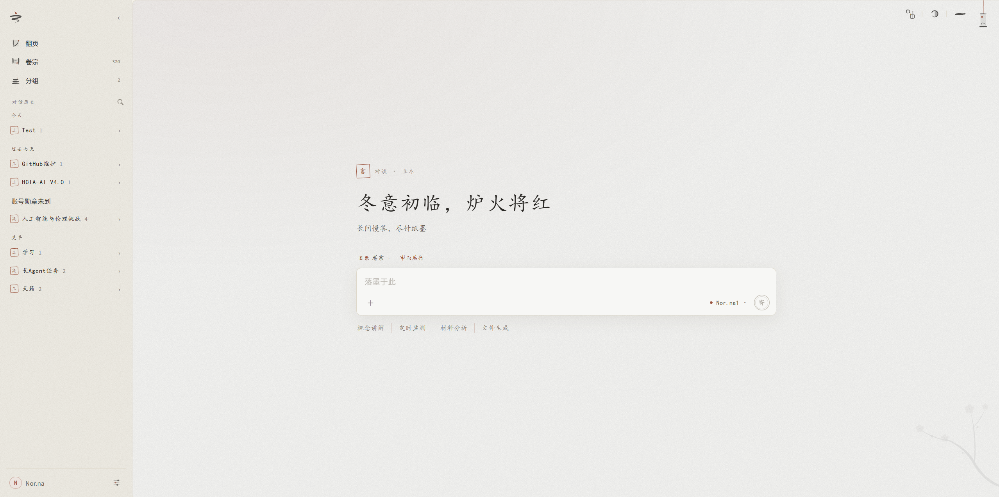

# Yan (言)

<p align="center">
  
</p>

[中文](README.md) · **English**

> Plainness for bones, paper and ink for spirit. Ask at length, answer at leisure; when the words are done, act.

Yan treats working with a model as writing on paper: questions and answers are set down in ink, every action the model takes is recorded as a step, and side questions go in the margin. On the same sheet, a conversation with no folder is a chat; bind it to a folder and the model reads and writes files and runs commands there until the job is done. It runs on your machine, with models you connect yourself.

<p align="center">
  
</p>

## Partner

<a href="https://siliconflow.cn" title="SiliconFlow"><picture><source media="(prefers-color-scheme: dark)" srcset="assets/powered-by-siliconflow-dark.png"></picture></a>

Yan partners with [SiliconFlow](https://siliconflow.cn). In **Settings → Model**, choose **SiliconFlow** as the API and paste your own API key. SiliconFlow's official guide [Using SiliconFlow in Yan](https://docs.siliconflow.cn/docs/usercases/use-siliconcloud-in-yan) (in Chinese) has step-by-step screenshots.

## Highlights

### Chat and Agent, divided by a folder

Most tools split chatting and agents into separate programs; Yan only asks whether this conversation is bound to a folder. Talk an idea through, bind a folder midway, and the model acts with the whole story behind it; the trade-offs you settled along the way don't need repeating. [More](docs/en/work.md)

### Side threads: questions in the margin

When something in a reply isn't clear, select it and a small conversation attached to that spot opens on the right. A side thread can read the main conversation, but the main conversation never sees it, so a detour never leaks into the main context. Switch to another version of the reply and its side threads hide, then reappear when you switch back. [More](docs/en/chat.md#sessions-and-input)

### Intent: long jobs that know what "done" means

For a job spanning several replies, the model keeps an **Intent** in the folder: which conclusions the job must establish, what each rests on, and which files or command outputs back it. When that evidence changes, whether by this reply, another conversation or your own hand, the item turns to needs recheck and everything depending on it lights up. When the model tries to finish, it's held once and asked to judge against your original question whether it's really done. Another conversation in the same folder picks up the same Intent; working practice and pitfalls go in a separate ledger. [More](docs/en/work.md#intent)

### Waits: leave it running, get woken when it's time

Training runs, builds, waiting on a PR review: the agent puts them in the background or sets a time, then finishes its reply instead of sitting awake. When the command ends or the time comes, it's woken to carry on. Subagents work the same way: start a training run, sleep, wake up to evaluate, then report back. [More](docs/en/work.md#waits)

### Follow-ups: cut in mid-answer

While the model is answering, add a line whenever something occurs to you. It isn't cut off and your words don't wait in a queue: they're handed over once it finishes the thought, the step or the sentence, and it can change course from there. If it's urgent, click ↵ on that step to hand it over at once. [More](docs/en/chat.md#generation-and-versions)

### Browser panel: watch it use the web

The browser the model uses sits in a panel on the right, with a red mark wherever it clicks or types, and you can take over at any time. Circle something or draw a line on the page to point it out. [More](docs/en/stage.md)

### Paper and ink, all the way through

It isn't a skin. Usage is ink running down; a year of usage is a page of ink dots, darker where you used more; sending is pressing a seal, playing music draws a brushed circle, and light and dark change like daylight. The interface and its motion share one brush.

## Also

Files and outputs (decks, spreadsheets and PDFs previewed in place), interactive charts in replies, subagents splitting up work, rolling a folder back to how it was before a reply, presets and groups, MCP and Skills, memory across conversations. Commands run under three permission levels with a sandbox on top, and a review model can judge the steps the rules aren't sure about against what you actually said. APIs: SiliconFlow, OpenAI compatible, Anthropic and ChatGPT subscription. Yan has no server of its own and your data stays on your machine; it needs only Node.js 22 and installs no dependencies. English and Chinese interfaces.

## Get started

**Windows**: download `yan-<version>-win-x64.zip` from [Releases](https://github.com/Master-Norna/yan/releases/latest), unzip it and double-click `言.exe`. `言.exe` is unsigned, so the first time Windows may say "Windows protected your PC"; click **More info → Run anyway**.

**From source**: install Node.js 22 or later, then double-click `start.cmd` (`start.command` on macOS), or run:

```powershell
npm start
```

Your browser opens `http://127.0.0.1:8787`. Add a model in **Settings → Model** and start writing; switch the interface to English in **Settings → General → Language**. The window opened by `start.cmd` is the local bridge and must stay open while you use Yan. For use inside VS Code, environment variables and macOS differences, see [Getting started](docs/en/start.md).

## Docs

In-app usage is under **Settings → Docs**; details and how things work are in the [docs](docs/en/README.md).

## Contributing

Issues and PRs are welcome. Before you start, please read [Contributing to Yan](CONTRIBUTING.en.md): workflow, running locally, and the project's trade-offs.

## License and credits

Released under Apache-2.0; see `LICENSE`. Open-source libraries shipped with the project: marked (MIT), DOMPurify (Apache-2.0), highlight.js (BSD-3-Clause), KaTeX (MIT), Mermaid (MIT), Apache ECharts (Apache-2.0), PDF.js (Apache-2.0). Full license texts are in `vendor/`.
