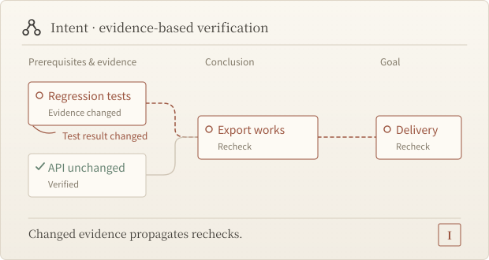
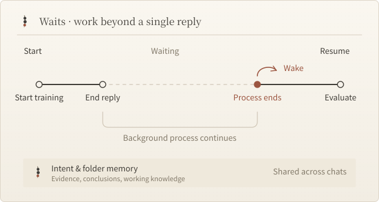
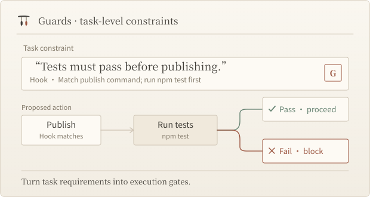
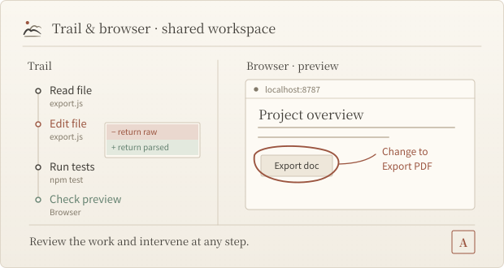

<div align="center">


<h1>言 · Yan</h1>

<strong>From a conversation to a finished piece of work.</strong>

<p>Plainness for bones, paper and ink for spirit.</p>

<a href="LICENSE"></a>
<a href="https://github.com/Master-Norna/yan/releases/latest"></a>
<a href="docs/en/models.md"></a>

[Download](https://github.com/Master-Norna/yan/releases/latest) · [Docs](docs/en/README.md) · [中文](README.md)

</div>

Yan brings conversation, research, development and task execution into one local environment. Choose your own models, continue work in a local folder, and inspect the execution trail and deliverables. A conversation becomes an agent workspace as soon as you bind it to a folder.

<p align="center">
  
</p>

## Distinctive capabilities

<table>
<tr>
<td width="45%" valign="middle"><h3>Evidence-based long-running work</h3><p>Intent structures work as conclusions, dependencies and acceptance evidence rather than a to-do list. Changed files, tests or probe results mark dependent conclusions for recheck. Before finishing, the model reassesses the original request.</p><a href="docs/en/work.md#intent">Learn more</a></td>
<td width="55%" valign="middle"></td>
</tr>
<tr>
<td width="55%" valign="middle"></td>
<td width="45%" valign="middle"><h3>Continuity across conversations</h3><p>Waits wake the model when a background command finishes or a timer fires, without spending inference on waiting. Subagents divide the work. Intent and folder memory persist across conversations so a new session can pick up progress and constraints.</p><a href="docs/en/work.md#waits">Learn more</a></td>
</tr>
<tr>
<td width="45%" valign="middle"><h3>Programmable task constraints</h3><p>Guards turn task requirements into executable hooks: match an action, test it, block it or request approval before execution. Tests and probes can also be rechecked before finishing. Constraints follow the task rather than relying only on prompts.</p><a href="docs/en/work.md#intent">Learn more</a></td>
<td width="55%" valign="middle"></td>
</tr>
<tr>
<td width="55%" valign="middle"></td>
<td width="45%" valign="middle"><h3>Reviewable, collaborative execution</h3><p>The trail records actions and file changes; the workspace exposes diffs and supports reply-level rollback. The browser panel shows the model's browser, which you can take over or annotate directly. Human and agent share the same working context.</p><a href="docs/en/stage.md">Learn more</a></td>
</tr>
</table>

## Product capabilities

| Conversation & creation | Search & research |
| --- | --- |
| Multi-turn chat, branches and versions, side threads, mid-reply follow-ups, attachments and interactive charts. | Web search, page reading, browser actions and annotated references. |
| **Code & files** | **Documents & delivery** |
| Read and edit files, search directories, run commands, inspect and roll back changes. | Manage files and preview documents, spreadsheets, slides and PDFs. |
| **Memory & personalization** | **Models & tools** |
| Cross-chat and folder memory, presets and conversation groups. | Choose your models; connect MCP, Skills and local tools. |

## Safety & control

Choose ask-first, review-first or direct execution to suit the situation. Permissions, sandbox rules, independent review and task guards provide separate control layers.

- **Rules & sandbox** — Restrict commands and file operations according to the permission level; block or ask about risky actions.
- **Independent review** — A separately configured model can assess ambiguous actions against the user's original request.
- **Task guards (Hook)** — Match specific commands, files, URLs or tools before side effects, with testing, blocking or approval.
- **Audit & rollback** — Inspect actions and file differences; roll back file changes made in a reply.

Actual protections depend on the selected permission level and configuration. [Permissions and sandbox](docs/en/sandbox.md).

## Paper and ink

<div align="center">
　　　
</div>

Paper-and-ink design connects brush icons, seal-like feedback, the ink calendar and daylight transitions into one visual language. Usage is ink running down; a year of usage is a page of ink dots, darker where usage is higher.

## Model choice & open ecosystem

Choose your own model APIs and specialized models for tasks such as review. Extend capabilities through MCP and Skills. Conversations and configuration are stored locally; content sent to a model or external tool is processed by that service. Supported interfaces include SiliconFlow, OpenAI-compatible APIs, Anthropic and ChatGPT subscription.

### Partner

<a href="https://siliconflow.cn" title="SiliconFlow"><picture><source media="(prefers-color-scheme: dark)" srcset="assets/powered-by-siliconflow-dark.png"></picture></a>

Yan partners with [SiliconFlow](https://siliconflow.cn). In **Settings → Model**, choose **SiliconFlow** as the API and paste your own API key. SiliconFlow's official guide [Using SiliconFlow in Yan](https://docs.siliconflow.cn/docs/usercases/use-siliconcloud-in-yan) (in Chinese) has step-by-step screenshots.

## Get started

**Windows**: download `yan-<version>-win-x64.zip` from [Releases](https://github.com/Master-Norna/yan/releases/latest), unzip it and double-click `言.exe`. `言.exe` is unsigned, so the first time Windows may say "Windows protected your PC"; click **More info → Run anyway**.

**macOS (Apple silicon)**: download `yan-<version>-mac-arm64.zip` from [Releases](https://github.com/Master-Norna/yan/releases/latest), unzip it and double-click `start.command` inside the `言` folder. Node is bundled. If macOS blocks the first launch, see [Getting started](docs/en/start.md#macos-portable-package).

**From source**: install Node.js 22 or later, then double-click `start.cmd` (`start.command` on macOS), or run:

```powershell
npm start
```

Your browser opens `http://127.0.0.1:8787`. Add a model in **Settings → Model** and start writing; switch the interface to English in **Settings → General → Language**. The window opened by `start.cmd` is the local bridge and must stay open while you use Yan. For use inside VS Code, environment variables and macOS differences, see [Getting started](docs/en/start.md).

## Docs

In-app usage is under **Settings → Docs**; details and how things work are in the [docs](docs/en/README.md).

## Contributing

Issues and PRs are welcome. Before you start, please read [Contributing to Yan](CONTRIBUTING.en.md): workflow, running locally, and the project's trade-offs.

## License and credits

Released under Apache-2.0; see `LICENSE`. Open-source libraries shipped with the project: marked (MIT), DOMPurify (Apache-2.0), highlight.js (BSD-3-Clause), KaTeX (MIT), Mermaid (MIT), Apache ECharts (Apache-2.0), PDF.js (Apache-2.0). Full license texts are in `vendor/`.

## Open-source contributions

Yan grows through real work in the open-source community. Contributions from Agent-Yan and the project maintainer are collected from public GitHub records, including jointly authored commits.

<p align="center">
  
</p>
