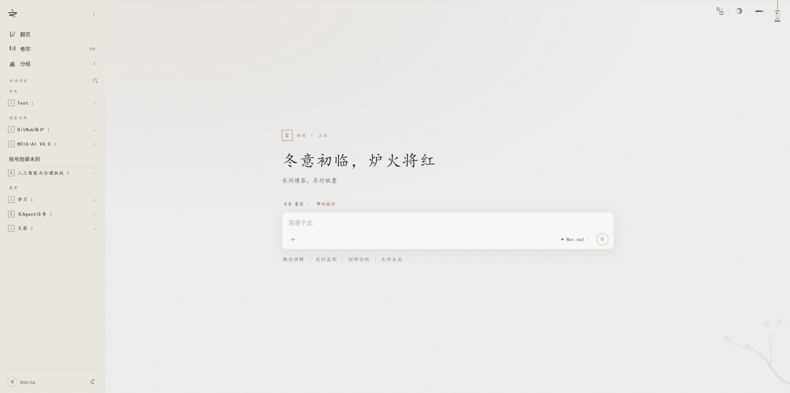

# 言

**中文** · [English](README.en.md)

一个本地运行、零依赖的聊天前端，接 OpenAI 兼容接口，也接 Anthropic 的 Messages API，界面取清简纸墨之意。同一段对话，绑上工作目录即是「行 · 执事」——一个只做代码工作的轻量 Agent，在那个目录里检索、读写、修改文件并执行指令；不绑目录即是「言 · 对谈」——照常聊，需要产出表格、文档、PDF 之类的文件时，同一套工具落在本机的「卷宗」目录里。

> 清简为骨，纸墨为意。长问慢答，尽付纸墨；言毕，即行。

<p align="center">
  
</p>

## 合作伙伴

<a href="https://siliconflow.cn" title="硅基流动 SiliconFlow"><picture><source media="(prefers-color-scheme: dark)" srcset="assets/powered-by-siliconflow-dark.png"></picture></a>

言与 [硅基流动 SiliconFlow](https://siliconflow.cn) 合作：在「设置 → 模型」的接口里选「硅基流动」，填上自己的 API Key 即可。图文步骤见硅基流动官方文档里的[《在言中使用硅基流动》](https://docs.siliconflow.cn/docs/usercases/use-siliconcloud-in-yan)。

## 特色

- **言与行，以目录为界**：不是两个入口，而是一段对话有没有绑工作目录；可先聊清一个想法，中途绑上目录再带着上下文动手。[详见](docs/work.md)
- **旁注追问**：在回复里划选一段，右侧开一条附在这一处的小对话——它读得到正文，正文永远读不到它，不明白的地方就地追问而不扰主线。[详见](docs/chat.md#会话与输入)
- **页内可视化**：模型写一页自足的 HTML，在隔离沙箱里就地渲染成可交互的一块，与正文同一张纸；ECharts、Mermaid 随项目本地分发，按需载。[详见](docs/chat.md#呈现)
- **长活自己跑得下去**：目录里立一份账本（约束与取舍）与一份「意」（要立住的结论图：前提、验收、凭据，凭据变了即转待复核），跨对话沿用；后台指令结束即叫醒模型，帮手可独自开训练、睡下、醒来评估再交差；上下文将满时自己压成工作笔记接着做。[详见](docs/work.md#意)
- **游目**：模型所用的浏览器收进右侧一栏，它点哪儿、输入什么看得见，也随时接得过手；圈点画面即可指给它看。[详见](docs/stage.md)
- **多方模型**：可添多个接口、切换默认模型，硅基流动、OpenAI 兼容、Anthropic 与 ChatGPT 订阅（官方登录）皆可，硅基流动填上 Key 即用（[接入说明](docs/siliconflow.md)）；思考档位按各家所认自动探明；「设置 → 专司」里另可配一份审查模型与生图模型。[详见](docs/models.md)
- **纸墨一以贯之**：印、砚、余墨、落墨与天光，界面与动效同一套笔墨。
- **本地、零依赖、可控**：数据只落在本机的存储目录（默认 `~/.yan/`），言没有自己的服务器，对话只发给你所接的模型接口；仅需 Node.js 22+（Windows 便携包自带），不装 npm 包；指令权限分三档、默认逐条请示，另套一层沙箱；审而后行里规则拿不准的一步，可交审查模型照你的原话再判。[存储](docs/storage.md) · [权限与沙箱](docs/sandbox.md)

另有卷宗、差遣（子 Agent）、预设、分组、MCP、沙箱环境、记忆、听音，见 [文档](docs/README.md)。

## 快速开始

**Windows，不想装 Node**：到 [Releases](https://github.com/Master-Norna/yan/releases/latest) 下载 `yan-<版本>-win-x64.zip`，解开后双击「言」文件夹里的 `言.exe` 即可——包里带着官方 Node，其余与下面一样。`言.exe` 未签名，头一回 Windows 若提示「已保护你的电脑」，点「更多信息 → 仍要运行」。[详见](docs/start.md#windows-便携包)

**从源码运行**：装好 Node.js 22 或更高版本，双击 `start.cmd`，或在项目目录运行：

```powershell
npm start
```

浏览器会打开 `http://127.0.0.1:8787`。在「设置 → 模型」中填写显示名称、模型 ID、Base URL 与 API Key 即可开始；界面可在「设置 → 通用 → 语言」切换为英文。`start.cmd` 打开的窗口即本机桥接，须保持开启。界面里的用法见「设置 → 文档」；VS Code 内使用、直接打开 `index.html`、环境变量见 [启动与运行](docs/start.md)。

macOS 上双击 `start.command`（头一回若被拦，在访达里右键选「打开」）。「环境」工具包只备了 Windows 版；沙箱规则按 PowerShell 写，在 macOS 上拦得较松。

## 参与开发

欢迎提 issue 与 PR。动手前请读 [参与言的开发](CONTRIBUTING.md)：流程、本地怎么跑、项目的几条取舍。

## 许可与致谢

本项目以 Apache-2.0 发布，全文见 `LICENSE`。随项目本地分发的开源库：marked（MIT）、DOMPurify（Apache-2.0）、highlight.js（BSD-3-Clause）、KaTeX（MIT）、Mermaid（MIT）、Apache ECharts（Apache-2.0）、PDF.js（Apache-2.0）。许可全文见 `vendor/`。
